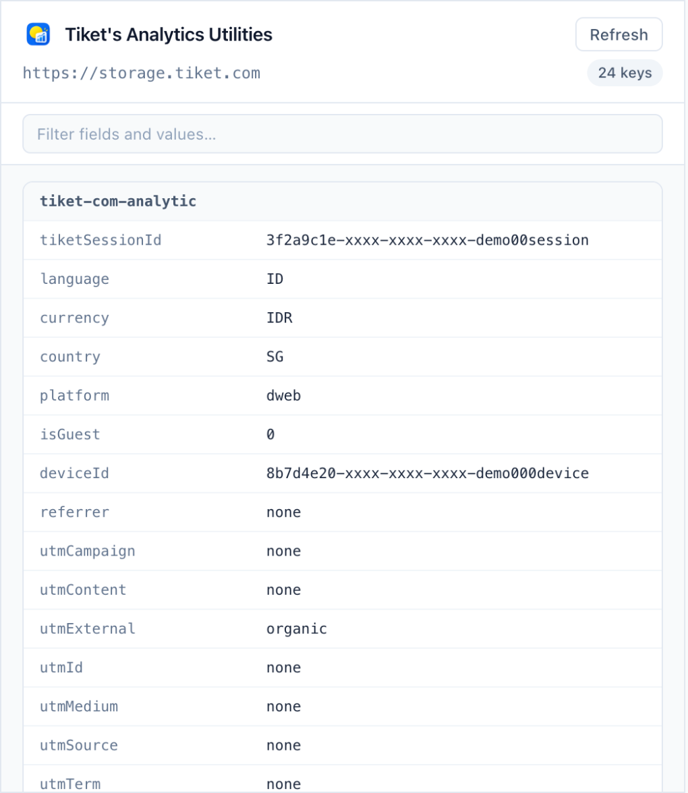
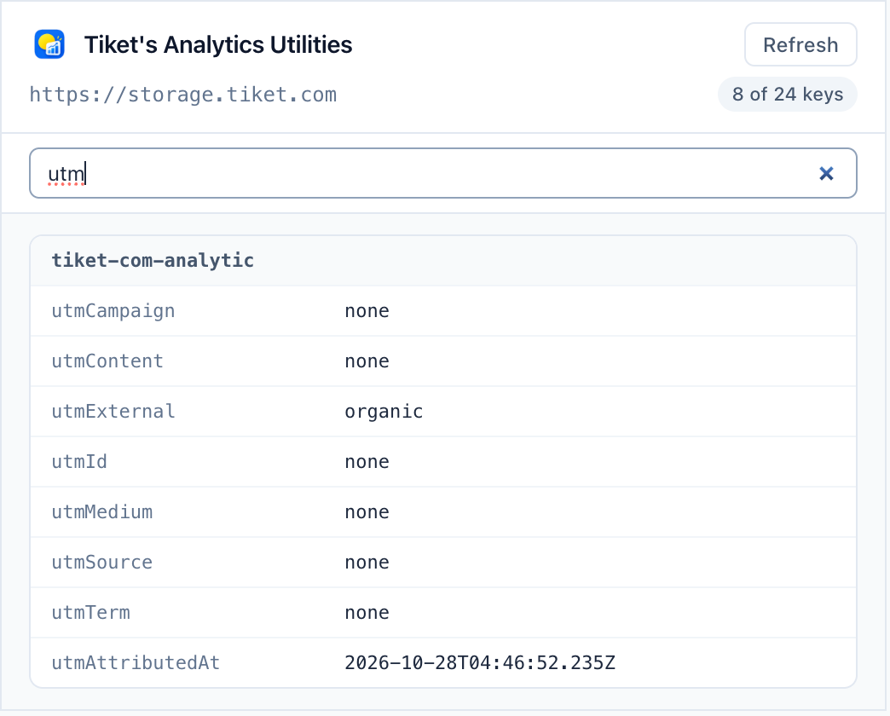
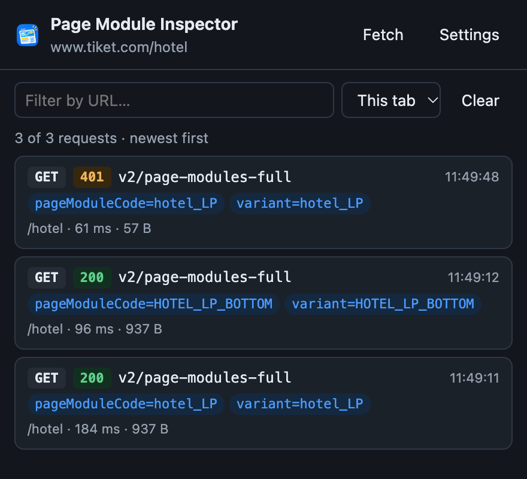
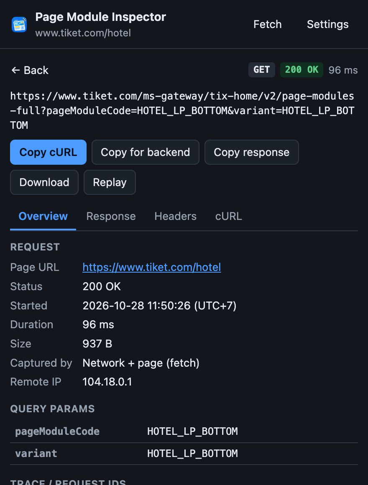
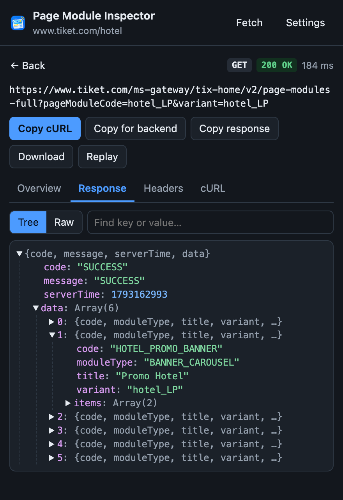
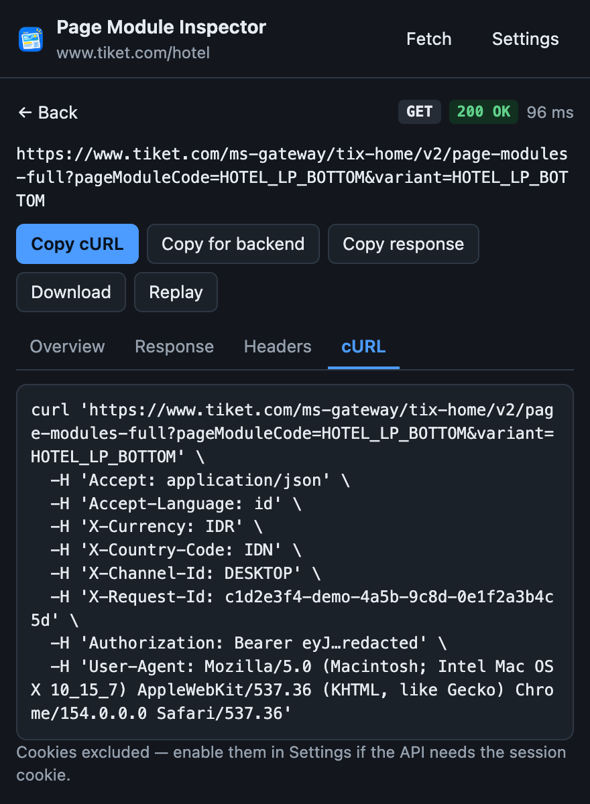

# Frontend Utilities

Chrome extensions (Manifest V3) for answering common tiket.com frontend questions without opening DevTools.

| Extension | UI | What it's for |
| --- | --- | --- |
| [tiket-analytics](tiket-analytics/) | Popup | Reads the `tiket-com-analytic` session data from the storage origin (`storage.<env>.tiket.com`). |
| [tiket-page-module](tiket-page-module/) | Side panel | Records `page-module` / `tix-home` API calls, shows the response, and copies a cURL or a report for the backend team. |

## Which tool answers which question

| Question | Tool → where |
| --- | --- |
| "What's my `tiketSessionId` / `deviceId`?" | Analytics → popup |
| "Which UTM source or campaign was attributed?" | Analytics → filter `utm` |
| "Am I seen as a guest or logged in? Which platform, currency or country?" | Analytics → `isGuest`, `loginStatus`, `platform`, `currency`, `country` |
| "Which page modules did `hotel_LP` return?" | Inspector → **Response** / **Overview › Modules** |
| "Why is a module missing?" | Inspector → status badge (401 / 5xx) and response `code`/`message` |
| "Can you send me the cURL / request ID?" | Inspector → **Copy cURL** / **Copy for backend** |
| "Does it still fail if I call it again?" | Inspector → **Replay** |
| "The page is SSR and no call shows up" | Inspector → **Fetch** (calls the API from inside the tab) |

## Install

1. Open `chrome://extensions` and turn on **Developer mode**.
2. Click **Load unpacked** and select `tiket-analytics/` or `tiket-page-module/`.
3. Open a tiket.com, preprod or gatotkaca tab, then click the extension icon.

Reload the extension in `chrome://extensions` after you change its code.

## Screenshots

> Captured with Claude in Chrome. The real extension UI was served on localhost with a stubbed `chrome.*` API. Analytics values come from a live tiket.com session (IDs masked). Module bodies are sample data, and secrets are redacted.

### tiket-analytics

| All fields | Filtered by `utm` |
| --- | --- |
|  |  |

The popup finds the storage origin from `#tiket-com-localstorage-iframe`, so it works in every environment without config. Nested values are flattened into dot paths. Click a value to copy it. To show more localStorage keys, add them to `retrievedLsKey` in [main.js](tiket-analytics/main.js).

### tiket-page-module

| Recorded calls | Overview |
| --- | --- |
|  |  |

| Response tree | cURL |
| --- | --- |
|  |  |

- The toolbar badge shows how many calls were recorded in the current tab.
- Change the URL patterns in **Settings**. Cookies are left out of a copied cURL unless you turn them on.
- Data stays in `chrome.storage.local`. It is cleared when the tab closes and when the browser restarts.

## More detail

- [tiket-analytics/README.md](tiket-analytics/README.md) explains how the popup reads cross-origin storage and how to rebuild Tailwind.
- [tiket-page-module/README.md](tiket-page-module/README.md) covers every feature, how it works, and its limits.
